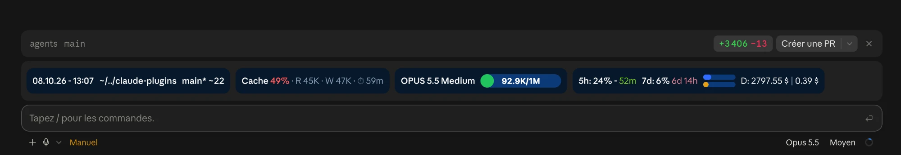

# fuse-statusline

Responsive statusline drawn above the prompt as a Claude Code mod. It picks its design from the surface it runs on and replaces the classic `statusLine` command line.

## Two Designs

The mod chooses the design from `e.surface` on every render — nothing to configure.

| Surface | Design |
|---------|--------|
| Claude app (desktop) | Rounded navy pills on one row. Card order: date / path / branch, Cache, model + effort + context pill with the tokens centered on it, 5h / 7d with stacked bars + today's spend and session cost. An extra-credits card appears only while credits are being spent |
| Terminal (CLI) | The look of the former core-guards statusline: same segments, glyphs and colors. Wraps responsively, always by whole segments |




## Engine

The figures come from the `core-guards/statusline` engine, run through `emit-data.ts`. The engine honours `config.json` (segment order, which segments show, bars), so the existing config command still applies:

```bash
bun --cwd ~/.claude/plugins/marketplaces/fusengine-plugins/plugins/core-guards/statusline run config
```

## Cache Card

| Piece | Meaning |
|-------|---------|
| Hit % | `read / (input + read + written)` on the last main turn (`turn.complete` usage, sub-agent turns ignored). Green at 80% and above, amber at 50% and above, red below |
| R / W | Tokens read from and written to the cache on that turn |
| Expiry timer | Time left before the cache lapses: amber under 2 min, red under 30 s, `expiré` at 0 |

The TTL is inferred, not read. In order: `FORCE_PROMPT_CACHING_5M` (5 min), `CLAUDE_CODE_PROMPT_CACHE_TTL` (`5m` / `1h`), `ENABLE_PROMPT_CACHING_1H` (1 h). Otherwise 1 h on a subscription within its plan, and 5 min on an API key or once extra credits are being spent. The `promptCacheTtl` setting cannot be read by a mod and is not taken into account.

## Usage Windows, Effort, Thinking, Fast

| Item | Source |
|------|--------|
| 5h / 7d | The session's rate-limit windows; falls back to the OAuth usage cache of the engine until the session has them (startup) |
| Effort / thinking / fast | Deduced at startup from env and settings (`CLAUDE_CODE_EFFORT_LEVEL`, `modelSettings`, `effortLevel`, `MAX_THINKING_TOKENS`, `alwaysThinkingEnabled`, `fastMode`). The effort of the real turn wins once a request has run |

## Known Limits

- No `± lines` (added / removed) figure.
- Thinking follows your settings, not what the model actually did.
- An empty line below the band comes from Claude Code itself.

## Install & Update

The installer (`setup.sh`) offers the mod as a recommended step (default: yes). Answering yes runs `claude plugin install fuse-statusline@fusengine-plugins`, enables it, and removes the classic `statusLine` — only when it is the one Fusengine installed; a custom `statusLine` is never touched. Answering no keeps the classic statusline. The marketplace must be added first (`/plugin marketplace add fusengine/agents`). With `--skip-env` the installer asks nothing.

To update, then start a new session:

```bash
claude plugin update fuse-statusline@fusengine-plugins
```
